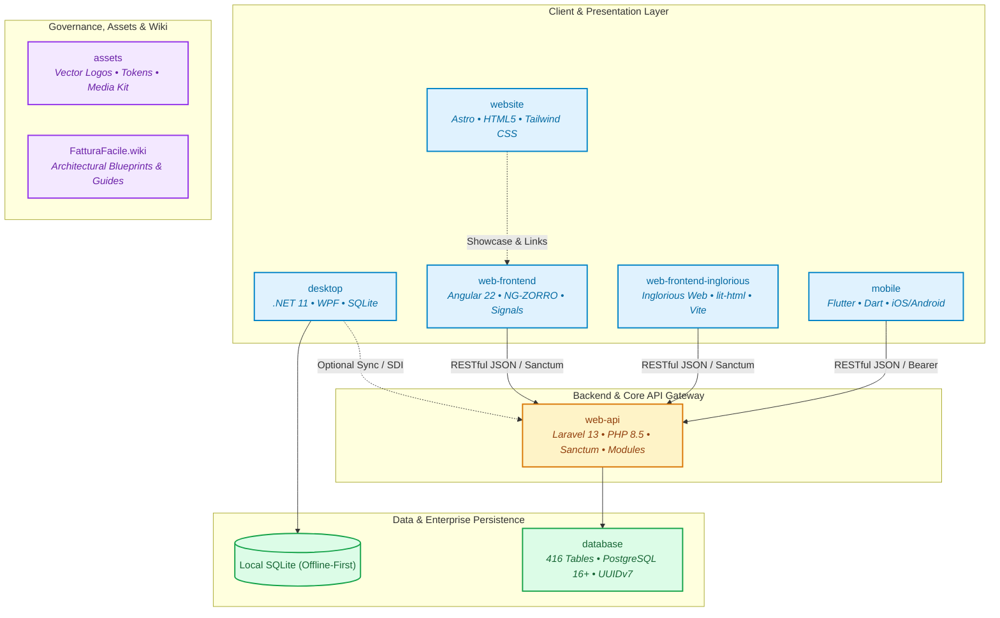
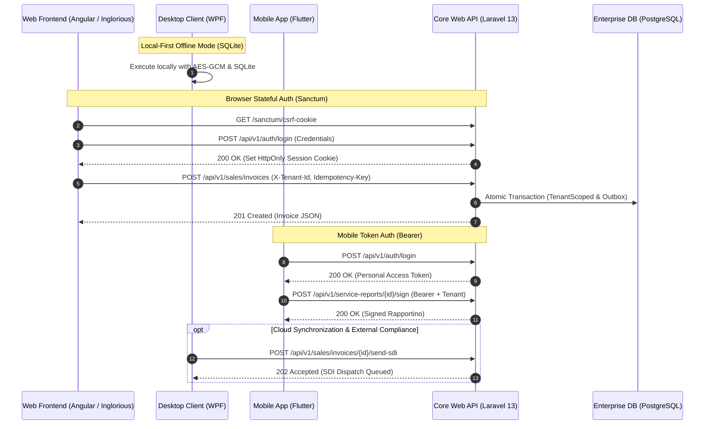

<div align="center">

# FatturaFacile

### Modern, Multi-Platform Invoicing & Business Management Suite

[](https://opensource.org/licenses/MIT)
[](https://github.com/FatturaFacile)
[](https://t.me/+sRauQINBDFQ5NjU0)
[](https://fatturafacile.eu)
[](https://demo.fatturafacile.eu/dashboard)
[](https://api.fatturafacile.eu/docs/api-docs.json)

An open-source, modular invoicing and enterprise ERP ecosystem tailored for freelancers, small-to-medium enterprises (SMEs), fiduciaries, and cross-border businesses across Switzerland and Italy. Engineered with clean code practices, modern cross-platform stacks, and strict regulatory compliance.

[Ecosystem & Vision](#-ecosystem-overview--vision) • [Repository Map](#-ecosystem-architecture--repository-map) • [Local Development & Integration](#-local-development--integration-overview) • [Standards & Compliance](#-standards--compliance) • [Documentation & Wiki](#-documentation--wiki-references) • [Contributing](#-contributing-community--license) • [License](#-license)

</div>

---

## 🎯 Ecosystem Overview & Vision

**FatturaFacile** simplifies invoicing, client billing, accounting, and multi-tier business operations by decoupling user experiences across desktop, web, and mobile clients while maintaining consistent, robust business logic and strict multi-tenancy.

Distributed under the permissive **MIT License**, FatturaFacile is engineered to eliminate vendor lock-in and deliver sovereign, localized business tools for the European market:

- **Swiss QR-Bill & Financial Compliance (CH):** Native generation and validation of Swiss QR-bills (*QR-Rechnung* - SPC 0200 / SIX Group v2.2) with QR-IBAN, Creditor Reference (QRR), and ISO 11649 Structured Creditor Reference (SCOR) using recursive Modulo 10 check digits. Support for deterministic 0.05 CHF Swiss cash rounding, Swiss SME Chart of Accounts (*KMU / PME Kontenrahmen*), ISO 20022 banking messaging (`pain.001`, `camt.053`, `camt.054`), Swiss Labour Act (*ArG / OLL 1*) weekly working limits (45h/50h statutory overtime caps), and revised Federal Act on Data Protection (*revFADP / nLPD*).
- **Italian Electronic Invoicing & SDI Compliance (IT):** Full lifecycle generation, pre-transmission validation, and management of Agenzia delle Entrate `FatturaPA v1.2` XML schemas (B2B, B2C, B2G formats `FPR12` / `FPA12`) for the Sistema di Interscambio (SDI), recipient code/PEC routing, ordinary and *forfettario* tax regimes, split payment, reverse charge (*autofatture*), withholding tax (*ritenuta d'acconto*), virtual stamp duty (*bollo virtuale*), Transport Documents (*DDT*), cash register fiscal receipts (*Registratore Telematico corrispettivi*), and D.Lgs. 66/2003 mandatory consecutive 11-hour daily rest monitoring.
- **Enterprise-Grade Architecture:** Decoupled multi-tier design influenced by tier-1 ERP platforms (SAP S/4HANA, Microsoft Dynamics 365, Odoo Enterprise). Accommodates single-database row-level multi-tenancy, immutable append-only audit ledgers, event outbox patterns, and flexible CQRS pipelines.
- **Data Sovereignty & Local-First Freedom:** Standalone offline-first desktop operations with local embedded SQLite persistence, alongside enterprise cloud scale-out powered by PostgreSQL and containerized services.

---

## 🏛 Ecosystem Architecture & Repository Map

The FatturaFacile ecosystem is organized into dedicated, decoupled repositories and directories, each serving a distinct operational role:



### Repository & Component Breakdown

| Repository / Folder | Role & Purpose | Primary Tech Stack | Key Architectural Features |
| :--- | :--- | :--- | :--- |
| **[`web-api/`](https://github.com/FatturaFacile/web-api)** | Central Multi-Tenant Enterprise ERP Backend | **PHP 8.5**, **Laravel 13**, PostgreSQL 16+ / SQLite, Redis, Laravel Sanctum, Spatie Permission | Modular Clean Architecture / DDD across 60+ bounded context modules (`02_CRM`, `05_Invoicing`, `06_SDI`, `13_Procurement`, `14_Inventory`, `18_HR`, `22_GeneralLedger`, `24_Treasury`), `/api/v1` REST API, row-level multi-tenancy (`TenantScope`), transactional Outbox pattern, immutable SHA-256 audit ledger, TOTP 2FA, SSO/SAML, and OpenAPI 3.1 generation. |
| **[`web-frontend/`](https://github.com/FatturaFacile/web-frontend)** | Enterprise Cloud Web ERP Single-Page Application | **Angular 22**, **TypeScript 6.0**, **NG-ZORRO** (Ant Design), `@ngrx/signals`, RxJS, Less/SCSS | 100% Standalone components, OnPush change detection, native control flow (`@if`, `@for`), dual-jurisdiction toggle (IT/CH), quad-lingual i18n (`it`, `en`, `de`, `fr`), Swiss QR-Bill generator, Italian SDI intake/tracking, dual ledger (Libro Giornale / Swiss KMU), virtual time clock, and PWA service worker. |
| **[`web-frontend-inglorious/`](https://github.com/FatturaFacile/web-frontend-inglorious)** | Lightweight ECS-Based Web ERP Client | **Inglorious Web**, **TypeScript**, **lit-html**, **Vite**, `@inglorious/store`, `@inglorious/ui` | High-performance alternative client built on Entity-Component-System (ECS) principles; shares backend contracts and translations while shipping ~80% less JavaScript/CSS (82.6 kB initial gzip), sub-second LCP, zero-dependency state management, and full route coverage. |
| **[`desktop/`](https://github.com/FatturaFacile/desktop)** | High-Performance Offline-First Windows ERP | **.NET 11** (C# Preview), **WPF**, **SQLite**, Entity Framework Core 11, Syncfusion WPF (`FluentDark`), CommunityToolkit.Mvvm | Strict Clean Architecture with **ZERO Tactical DDD Mandate** (pure POCO entities, MediatR CQRS handlers, localized Country Strategies for CH/IT), row-level SQLite multi-tenancy, Windows Hello biometric/PIN authentication (`UserConsentVerifier`), AES-GCM field encryption via DPAPI, Inno Setup installer, and offline-first data sovereignty. |
| **[`mobile/`](https://github.com/FatturaFacile/mobile)** | Cross-Platform Field Service & Billing Companion | **Flutter** (SDK `>=3.13.5`), **Dart**, Material Design 3, Cupertino UI | Unified cross-platform codebase for iOS and Android; field invoicing, digital customer signature capture on service intervention reports (*rapportini*), offline persistent caching, receipt/expense scanning, and GPS-enabled time tracking. |
| **[`database/`](https://github.com/FatturaFacile/database)** | Enterprise Relational Database Schema & Models | **PostgreSQL 16+**, **MySQL**, **SQLite**, ANSI SQL DDL | Authoritative relational model defining **416 tables** and **696 foreign keys** across 17 architectural domains, topological order for direct DBeaver ER diagram import, UUIDv7 primary keys, tenant scoping matrix (`tenant_id`), composite uniqueness rules, and fiscal deletion policies (`ON DELETE RESTRICT`). |
| **[`website/`](https://github.com/FatturaFacile/website)** | Official Showcase & Institutional Hub | **Astro**, **HTML5 Semantic**, **Tailwind CSS**, TypeScript, Vanilla JavaScript | Zero-build/high-speed static architecture powering [fatturafacile.eu](https://fatturafacile.eu); responsive dark/light mode, client-side quad-lingual switcher (`en`, `it`, `fr`, `de`), interactive EU GDPR & Swiss nLPD compliance modal, Schema.org JSON-LD SEO, and GitHub Pages deployment. |
| **[`assets/`](https://github.com/FatturaFacile/assets)** | Official Brand Identity & Media Kit | **SVG Vector**, **PNG** (1x–4x), **Design Tokens**, Inter & Merriweather Fonts | Master brand repository containing logos, app icons, technology badges, color palette guidelines (Primary Navy `#0F172A`, Accent Emerald `#10B981`), UI screenshots, presentation slide decks (`docs/`), and CC BY 4.0 media licensing. |
| **[`FatturaFacile.wiki/`](https://github.com/FatturaFacile/FatturaFacile.wiki)** | Engineering & Technical Architecture Documentation | **Markdown**, Mermaid Diagrams | Comprehensive developer wiki documenting system architecture, cross-border fiscal rule engines, CI/CD workflows, branching conventions, environment topologies, and contribution standards. |

---

## 🔄 Local Development & Integration Overview

The decoupled clients and backend services integrate through standardized HTTP/REST APIs, shared data contracts, and cross-platform synchronization protocols:



### Integration Contracts & Protocol Highlights

1. **Authentication & Multi-Tenant Context:**
   - **Web Single-Page Apps (`web-frontend`, `web-frontend-inglorious`):** Authenticate via Laravel Sanctum stateful cookie authentication. Dev proxy configurations forward `/api` and `/sanctum` from `localhost:4200` to the API backend, ensuring first-party cookie context.
   - **Mobile Client (`mobile`):** Connects to `/api/v1` using Sanctum personal access Bearer tokens (`Authorization: Bearer <token>`).
   - **Tenant Scoping:** Every authenticated request must supply the active tenant UUID via the `X-Tenant-Id` header (or rely on the user's primary assigned tenant). Models in the database automatically enforce `WHERE tenant_id = ?`.
2. **Offline-First & Local Storage:**
   - The **Desktop Client** runs standalone without a server requirement, reading/writing to `%LocalAppData%\FatturaFacile\fattura-facile.sqlite`. Sensitive fields are protected via DPAPI/AES-GCM encryption.
   - The **Mobile App** incorporates local caching to queue field actions (e.g., photo receipt scans, work orders) when operating in remote or low-connectivity environments.
3. **Fiscal Engine Interoperability:**
   - OpenAPI specifications (`web-api/docs/api-docs.json`) define the canonical contract. Frontend clients generate typed models (`pnpm run api:generate`) ensuring schema alignment for Swiss QR-Bill data structures, Italian FatturaPA XML nodes, and ISO 20022 message formats.

---

## 🚀 Getting Started

Each component can be developed and run independently. Follow the prerequisites and steps for the module you wish to launch:

### 1. Central API Backend (`web-api`)
Requires **PHP 8.5+**, **Composer 2.6+**, and **PostgreSQL 16+** (or SQLite for fast testing):
```bash
git clone https://github.com/FatturaFacile/web-api.git
cd web-api
composer install
cp .env.example .env
php artisan key:generate

# Fast start with local SQLite:
touch database/database.sqlite
php artisan migrate
php artisan erp:bootstrap

# Or launch local PostgreSQL & Mailpit via Docker Compose:
docker compose -f docker-compose.local.yml up -d --wait
php artisan migrate
php artisan erp:bootstrap

php artisan serve
```

### 2. Angular Enterprise Web Client (`web-frontend`)
Requires **Node.js 22+** and **pnpm 10+** (project locked to `pnpm@12.18.0`):
```bash
git clone https://github.com/FatturaFacile/web-frontend.git
cd web-frontend
pnpm install --frozen-lockfile

# Generate local SSL certs for HTTPS (mkcert):
mkcert -cert-file certs/localhost.crt -key-file certs/localhost.key localhost 127.0.0.1

# Start development server on https://localhost:4200:
pnpm run start:local
```

### 3. Inglorious Web Client (`web-frontend-inglorious`)
Requires **Node.js 26+** and **pnpm 12+**:
```bash
git clone https://github.com/FatturaFacile/web-frontend-inglorious.git
cd web-frontend-inglorious
pnpm install
pnpm dev
# Opens at http://localhost:4200 (or https://localhost:4200 with mkcert)
```

### 4. Desktop Client (`desktop`)
Requires **Windows 10/11** and **.NET 11 SDK**:
```powershell
git clone https://github.com/FatturaFacile/desktop.git
cd desktop
dotnet restore FatturaFacile.slnx
dotnet build FatturaFacile.slnx
dotnet run --project src/FatturaFacile.Wpf/FatturaFacile.Wpf.csproj
```

### 5. Mobile Application (`mobile`)
Requires **Flutter SDK 3.13.5+** and platform toolchains (Android Studio / Xcode):
```bash
git clone https://github.com/FatturaFacile/mobile.git
cd mobile/src
flutter pub get
flutter analyze
flutter test
flutter run
```

### 6. Showcase Website (`website`)
Requires **Node.js 22+**:
```bash
git clone https://github.com/FatturaFacile/website.git
cd website
npm ci
npm run dev
# Opens at http://localhost:4321
```

---

## 📚 Documentation & Wiki References

Deep technical guides, architectural decision records, and operational manuals are maintained in the documentation wiki ([`FatturaFacile.wiki/`](https://github.com/FatturaFacile/FatturaFacile.wiki)):

- **[Master System Architecture](https://github.com/FatturaFacile/FatturaFacile.wiki/blob/main/Architecture.md):** Clean Architecture boundaries, CQRS command bus pipelines, cross-border fiscal engines, and security models.
- **[Ecosystem & Repository Blueprint](https://github.com/FatturaFacile/FatturaFacile.wiki/blob/main/Ecosystem.md):** Granular module-by-module breakdown and responsibility matrix.
- **[Configuration & Environments](https://github.com/FatturaFacile/FatturaFacile.wiki/blob/main/Configuration-And-Environments.md):** Infrastructure topology, dev/demo/production deployment parameters, and secret naming conventions.
- **[Workflows & CI/CD Pipelines](https://github.com/FatturaFacile/FatturaFacile.wiki/blob/main/Workflows-And-CI-CD.md):** Git branching models, quality gates, automated test runners, and release tagging protocols.
- **[Database Architecture & Schema Index](https://github.com/FatturaFacile/database/blob/main/README.md):** Multi-tenancy isolation models, UUIDv7 conventions, DBeaver CE ER import instructions, and schema catalog.
- **[Brand Style Guide & Assets](https://github.com/FatturaFacile/assets/blob/main/README.md):** Master color palette, typography specifications (Inter / Merriweather), and media usage policies.

---

## 🤝 Contributing, Community & License

We warmly welcome community involvement, issue reports, localization additions, and code contributions!

### How to Contribute
1. **Explore the Wiki:** Review [Contributing Guidelines](https://github.com/FatturaFacile/FatturaFacile.wiki/blob/main/Contributing.md) for testing expectations and coding styles.
2. **Fork & Branch:** Create a topical feature or fix branch from `main` (or `dev` depending on the repository):
   ```bash
   git checkout -b feat/swiss-qr-scor-validator
   ```
3. **Commit Cleanly:** Follow Conventional Commits:
   ```bash
   git commit -m "feat(billing): add recursive modulo 10 scor validator"
   ```
4. **Submit a PR:** Push your branch and open a Pull Request against the appropriate upstream repository.

### Community & Channels
- **Telegram Group:** Join discussions in our [Telegram Community](https://t.me/+sRauQINBDFQ5NjU0).
- **Public Website:** Explore feature tours and interactive overviews at [fatturafacile.eu](https://fatturafacile.eu).
- **Live Demo:** Test drive the web ERP at [demo.fatturafacile.eu/dashboard](https://demo.fatturafacile.eu/dashboard).
- **API Documentation:** Inspect the interactive schema at [api.fatturafacile.eu/docs/api-docs.json](https://api.fatturafacile.eu/docs/api-docs.json).

### Security Disclosures
If you discover a security-related vulnerability, please disclose it responsibly via GitHub Security Advisories or by contacting the core team directly at **security@fatturafacile.eu**.

---

## 📄 License

The entire FatturaFacile software ecosystem is open source licensed under the **[MIT License](https://opensource.org/licenses/MIT)**.

```text
MIT License

Copyright (c) 2026 FatturaFacile

Permission is hereby granted, free of charge, to any person obtaining a copy
of this software and associated documentation files (the "Software"), to deal
in the Software without restriction, including without limitation the rights
to use, copy, modify, merge, publish, distribute, sublicense, and/or sell
copies of the Software, and to permit persons to whom the Software is
furnished to do so, subject to the following conditions:

The above copyright notice and this permission notice shall be included in all
copies or substantial portions of the Software.
```

*(Note: Brand vector marks and graphical assets in [`assets/`](https://github.com/FatturaFacile/assets) are licensed under [CC BY 4.0](https://creativecommons.org/licenses/by/4.0/), and embedded fonts retain their respective SIL Open Font License 1.1).*

---

<div align="center">
  <sub>Maintained with ❤️ by the <b>FatturaFacile</b> open-source community</sub>
</div>
