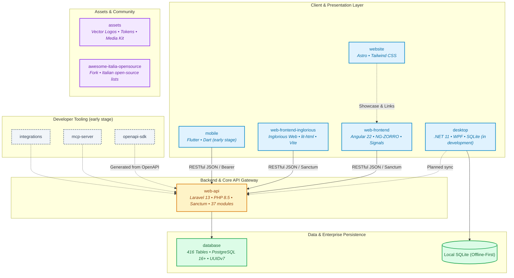
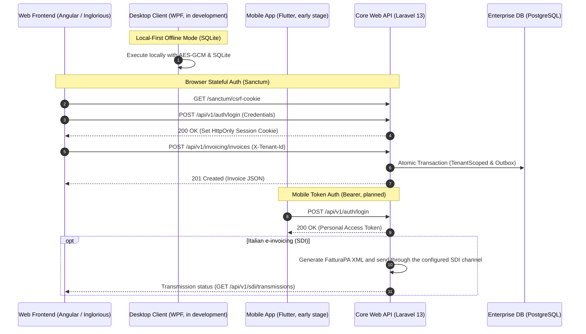

<div align="center">

# FatturaFacile

### Free, Open Source, Modular ERP: Quotes & Invoices First

[](https://opensource.org/licenses/MIT)
[](#-contributing-community--license)
[](https://t.me/+sRauQINBDFQ5NjU0)
[](https://fatturafacile.eu)
[](https://demo.fatturafacile.eu)
[](https://api.fatturafacile.eu/docs)
[](https://status.fatturafacile.eu)

**FatturaFacile is a free, open source, modular ERP (*gestionale*) for freelancers, craftspeople and small-to-medium enterprises, not only an invoicing tool.** Start with quotes and invoices, then turn on only the modules you need. Electronic invoicing for Italy (FatturaPA / SDI) and QR-bill for Switzerland are supported; modules that are still in development are marked as such.

[Ecosystem & Vision](#-ecosystem-overview--vision) • [Repository Map](#-ecosystem-architecture--repository-map) • [Integration Overview](#-local-development--integration-overview) • [Getting Started](#-getting-started) • [Documentation](#-documentation-references) • [Contributing](#-contributing-community--license) • [License](#-license)

</div>

---

## 🎯 Ecosystem Overview & Vision

**FatturaFacile** is a modular ERP: you start from quotes and invoices and enable only the modules you need (for example stock, jobs, cash, subscriptions or accounting). If you do not need a module, you do not see it. Clients (web, desktop, mobile) share the same backend contracts and strict multi-tenancy.

Distributed under the permissive **MIT License**, FatturaFacile avoids vendor lock-in and targets the European market, with a focus on Italy and Switzerland.

### Available today
- **Quotes and invoices** on the web ERP ([demo](https://demo.fatturafacile.eu)), backed by the Laravel API.
- **Italy (IT):** FatturaPA XML generation and SDI transmission tracking, with an SDI channel/gateway integration in the API. Related tax handling (split payment, withholding tax, virtual stamp duty) is modelled in the invoicing code.
- **Switzerland (CH):** Swiss QR-bill (SIX v2.2) generation, QR-IBAN and SCOR/QRR references, and ISO 20022 messages (`pain.001`, `camt.053`, `camt.054`) in treasury.
- **Platform:** row-level multi-tenancy (`X-Tenant-Id`), role-based permissions, TOTP two-factor authentication, OpenID Connect single sign-on (SAML is not supported), an append-only audit ledger, quadrilingual UI (`it`, `en`, `de`, `fr`) and an OpenAPI 3.1 specification.
- **Many further modules** exist in `web-api` (CRM, procurement, inventory, general ledger, treasury, HR, projects, manufacturing and more) with matching screens in `web-frontend`. Their maturity varies: treat anything beyond quotes, invoices and compliance as work in progress and check the [website module list](https://fatturafacile.eu) for the current status.

### In development and roadmap
- **Desktop client** (Windows, offline-first, SQLite): in development.
- **Mobile app** (Flutter): early stage; field-service features (signed service reports, receipt scanning, time tracking) are planned, not yet shipped.
- **Payment schedules** (in development), **simplified stock**, **cash register integration** and **advanced address book** (planned or on the community backlog).
- **`mcp-server`, `integrations` and `openapi-sdk`:** repositories created on 2026-11-16 as placeholders; no features yet.
- Compliance is a goal, not a certification: validate invoices and bookkeeping with your accountant before relying on them for filings.

---

## 🏛 Ecosystem Architecture & Repository Map

The FatturaFacile ecosystem is organized into dedicated, decoupled repositories, each serving a distinct role. The org also contains a `FatturaFacile` repository (this one, with the org-level README) and private demo repositories that are not part of the product.



### Repository & Component Breakdown

| Repository / Folder | Role & Purpose | Primary Tech Stack | Key Architectural Features |
| :--- | :--- | :--- | :--- |
| **[`web-api/`](https://github.com/FatturaFacile/web-api)** | Central Multi-Tenant Enterprise ERP Backend | **PHP 8.5**, **Laravel 13**, PostgreSQL 16+ / SQLite, Redis, Laravel Sanctum, Spatie Permission | Modular Clean Architecture / DDD across 37 modules in `modules/` (for example `02_CRM`, `05_Invoicing`, `06_SDI`, `13_Procurement`, `14_Inventory`, `22_GeneralLedger`, `24_Treasury`), `/api/v1` REST API, row-level multi-tenancy (`TenantScope`), transactional Outbox pattern, SHA-256 audit ledger, TOTP 2FA, OpenID Connect SSO and SCIM, and an OpenAPI 3.1 specification. Module maturity varies. Default branch for development: `dev`. |
| **[`web-frontend/`](https://github.com/FatturaFacile/web-frontend)** | Web ERP Single-Page Application (the main client; powers the [demo](https://demo.fatturafacile.eu)) | **Angular 22**, **TypeScript 6.0**, **NG-ZORRO** (Ant Design), `@ngrx/signals`, RxJS, Less/SCSS | 100% Standalone components, OnPush change detection, native control flow (`@if`, `@for`), dual-jurisdiction toggle (IT/CH), quad-lingual i18n (`it`, `en`, `de`, `fr`), Swiss QR-Bill generator, Italian SDI transmission tracking, dual ledger (Libro Giornale / Swiss KMU) and a PWA service worker. Development branch: `dev`. |
| **[`web-frontend-inglorious/`](https://github.com/FatturaFacile/web-frontend-inglorious)** | Lightweight ECS-Based Web ERP Client (experimental alternative to `web-frontend`) | **Inglorious Web**, **TypeScript**, **lit-html**, **Vite**, `@inglorious/store`, `@inglorious/ui` | High-performance alternative client built on Entity-Component-System (ECS) principles; port of the Angular client that uses the same backend API and translations while shipping about a fifth of the initial JavaScript/CSS (see its `BENCHMARKS.md`). |
| **[`desktop/`](https://github.com/FatturaFacile/desktop)** | Offline-First Windows ERP (in development) | **.NET 11** (C# Preview), **WPF**, **SQLite**, Entity Framework Core 11, Syncfusion WPF (`FluentDark`), CommunityToolkit.Mvvm | Strict Clean Architecture with **ZERO Tactical DDD Mandate** (pure POCO entities, MediatR CQRS handlers, localized Country Strategies for CH/IT), row-level SQLite multi-tenancy, Windows Hello biometric/PIN authentication (`UserConsentVerifier`), AES-GCM field encryption via DPAPI, Inno Setup installer, and offline-first data sovereignty. |
| **[`mobile/`](https://github.com/FatturaFacile/mobile)** | Cross-Platform Mobile Companion (early stage) | **Flutter** (SDK `>=3.13.5`), **Dart**, Material Design 3, Cupertino UI | Flutter scaffold for iOS and Android. Planned: field invoicing, digital signatures on service reports (*rapportini*), offline caching, receipt scanning and time tracking. These are not implemented yet. |
| **[`database/`](https://github.com/FatturaFacile/database)** | Enterprise Relational Database Schema & Models | **PostgreSQL 16+**, **MySQL**, **SQLite**, ANSI SQL DDL | Authoritative relational model defining **416 tables** and over 1,000 foreign keys across 17 architectural domains, topological order for direct DBeaver ER diagram import, UUIDv7 primary keys, tenant scoping matrix (`tenant_id`), composite uniqueness rules, and fiscal deletion policies (`ON DELETE RESTRICT`). |
| **[`website/`](https://github.com/FatturaFacile/website)** | Official Showcase & Institutional Hub | **Astro**, **HTML5 Semantic**, **Tailwind CSS**, TypeScript, Vanilla JavaScript | Static site powering [fatturafacile.eu](https://fatturafacile.eu): quad-lingual (`it`, `en`, `de`, `fr`), dark/light mode, module list with status (available / in development / planned), Schema.org JSON-LD. Pull requests go to `main`. |
| **[`assets/`](https://github.com/FatturaFacile/assets)** | Official Brand Identity & Media Kit | **SVG Vector**, **PNG** (1x–4x), **Design Tokens**, Inter & Merriweather Fonts | Master brand repository containing logos, app icons, technology badges, color palette guidelines (Primary Navy `#0F172A`, Accent Emerald `#10B981`), UI screenshots, presentation slide decks (`docs/`), and CC BY 4.0 media licensing. |
| **[`mcp-server/`](https://github.com/FatturaFacile/mcp-server)** | Model Context Protocol server for the API (planned) | n/a | Created 2026-11-16 (renamed from `fatturafacile-mcp-server`); placeholder, no code yet. |
| **[`integrations/`](https://github.com/FatturaFacile/integrations)** | Third-party integrations (planned) | n/a | Created 2026-11-16 (renamed from `fatturafacile-integrations`); placeholder, no code yet. |
| **[`openapi-sdk/`](https://github.com/FatturaFacile/openapi-sdk)** | Client SDKs generated from the OpenAPI spec (planned) | n/a | Created 2026-11-16 (renamed from `fatturafacile-openapi-sdk`); placeholder, no code yet. |
| **[`awesome-italia-opensource/`](https://github.com/FatturaFacile/awesome-italia-opensource)** | Fork of the [Italia Open-Source](https://github.com/italia-opensource/awesome-italia-opensource) awesome lists | Markdown | Used to list FatturaFacile among Italian open-source projects; not part of the product. |

---

## 🔄 Local Development & Integration Overview

The decoupled clients and backend services integrate through standardized HTTP/REST APIs, shared data contracts, and cross-platform synchronization protocols:



### Integration Contracts & Protocol Highlights

1. **Authentication & Multi-Tenant Context:**
   - **Web Single-Page Apps (`web-frontend`, `web-frontend-inglorious`):** Authenticate via Laravel Sanctum stateful cookie authentication. Dev proxy configurations forward `/api` and `/sanctum` from `localhost:4200` to the API backend, ensuring first-party cookie context.
   - **Mobile Client (`mobile`, planned):** Will connect to `/api/v1` using Sanctum personal access Bearer tokens (`Authorization: Bearer <token>`).
   - **Tenant Scoping:** Every authenticated request must supply the active tenant UUID via the `X-Tenant-Id` header (or rely on the user's primary assigned tenant). Models in the database automatically enforce `WHERE tenant_id = ?`.
2. **Offline-First & Local Storage:**
   - The **Desktop Client** (in development) is designed to run standalone without a server requirement, reading/writing to `%LocalAppData%\FatturaFacile\fattura-facile.sqlite`. Sensitive fields are protected via DPAPI/AES-GCM encryption.
   - The **Mobile App** is planned to cache field actions for low-connectivity use; this is not implemented yet.
3. **Fiscal Engine Interoperability:**
   - The OpenAPI specification (`web-api/docs/api/openapi.json`, also served at [api.fatturafacile.eu/docs](https://api.fatturafacile.eu/docs)) defines the canonical contract. `web-frontend` generates typed models (`pnpm run api:generate`, which expects `web-api` cloned next to it) ensuring schema alignment for Swiss QR-Bill data structures, Italian FatturaPA XML nodes, and ISO 20022 message formats.

---

## 🚀 Getting Started

Each component can be developed and run independently. `web-api` and `web-frontend` use `dev` as the integration branch (pull requests target `dev`; production is released from `main` with `vX.Y.Z` tags), so clone and check out `dev` for local work. The other repositories use `main`.

### 1. Central API Backend (`web-api`)
Requires **PHP 8.5+**, **Composer 2.6+**, and **PostgreSQL 16+** (or SQLite for fast testing):
```bash
git clone -b dev https://github.com/FatturaFacile/web-api.git
cd web-api
composer install
cp .env.example .env
php artisan key:generate

# Fast start with local SQLite:
touch database/database.sqlite
php artisan migrate
php artisan erp:bootstrap

# Or launch local PostgreSQL & Mailpit via Docker Compose (file available on `dev`; set the DB_* values in .env first):
docker compose -f docker-compose.local.yml up -d --wait
php artisan migrate
php artisan erp:bootstrap

php artisan serve
```

### 2. Angular Enterprise Web Client (`web-frontend`)
Requires **Node.js 22+**, **pnpm 10+** (the repo pins `pnpm@12.18.0` through `packageManager`) and [mkcert](https://github.com/FiloSottile/mkcert). The app expects a running `web-api`:
```bash
git clone -b dev https://github.com/FatturaFacile/web-frontend.git
cd web-frontend
pnpm install --frozen-lockfile

# Generate local SSL certs for HTTPS (mkcert):
mkdir -p certs && mkcert -install
mkcert -cert-file certs/localhost.crt -key-file certs/localhost.key localhost 127.0.0.1

# Start development server on https://localhost:4200:
pnpm run start:local
```

### 3. Inglorious Web Client (`web-frontend-inglorious`)
Requires **Node.js 26+** and **pnpm 12+**. It talks to the same `web-api`:
```bash
git clone https://github.com/FatturaFacile/web-frontend-inglorious.git
cd web-frontend-inglorious
pnpm install
pnpm dev
# Opens at http://localhost:4200 (or https://localhost:4200 with mkcert)
```

### 4. Desktop Client (`desktop`, in development)
Requires **Windows 10/11** and **.NET 11 SDK**:
```powershell
git clone https://github.com/FatturaFacile/desktop.git
cd desktop
dotnet restore FatturaFacile.slnx
dotnet build FatturaFacile.slnx
dotnet run --project src/FatturaFacile.Wpf/FatturaFacile.Wpf.csproj
```

### 5. Mobile Application (`mobile`, early stage)
Requires **Flutter SDK 3.13.5+** and platform toolchains (Android Studio / Xcode):
```bash
git clone https://github.com/FatturaFacile/mobile.git
cd mobile/src
flutter pub get
flutter analyze
flutter test
flutter run
```

### 6. Showcase Website (`website`)
Requires **Node.js 22.23+**:
```bash
git clone https://github.com/FatturaFacile/website.git
cd website
npm ci
npm run dev
# Opens at http://localhost:4321
```

`mcp-server`, `integrations` and `openapi-sdk` have no code yet, so there is nothing to run.

---

## 📚 Documentation References

Technical documentation lives next to the code in each repository:

- **[`web-api` architecture](https://github.com/FatturaFacile/web-api/blob/dev/ARCHITECTURE.md) and [`docs/`](https://github.com/FatturaFacile/web-api/tree/dev/docs):** module layout, multi-tenancy, API specification and the OpenAPI/Postman files in `docs/api/`.
- **[API reference](https://api.fatturafacile.eu/docs):** interactive OpenAPI documentation (raw spec: [api-docs.json](https://api.fatturafacile.eu/docs/api-docs.json)).
- **[`web-frontend/docs`](https://github.com/FatturaFacile/web-frontend/tree/dev/docs):** frontend architecture and conventions.
- **[Database Architecture & Schema Index](https://github.com/FatturaFacile/database/blob/main/README.md):** multi-tenancy isolation, UUIDv7 conventions, schema catalog and ER diagram.
- **[Brand Style Guide & Assets](https://github.com/FatturaFacile/assets/blob/main/README.md):** color palette, typography and media usage.
- **[Service status](https://status.fatturafacile.eu):** uptime of the public services.

---

# 🚀 Join FatturaFacile

FatturaFacile is a free and open-source ERP built by the community.

We are creating a collaborative ecosystem of developers, designers, testers, students, translators and contributors from Italy, Switzerland and the rest of Europe.

Whether you are an experienced professional or a student looking for real-world open-source experience, you are welcome to join us.

## 👥 We're Looking For

- Laravel / PHP Developers
- Angular Developers
- Flutter Developers
- .NET Developers
- Full Stack Developers
- QA Testers
- Technical Writers
- Documentation Contributors
- UI / UX Designers
- Translators (IT, EN, DE, FR)
- Marketing & Communication Contributors
- Community Managers
- Computer Science Students
- Junior Developers
- Open Source Enthusiasts

## 🌟 Why Join?

- Work on a real-world ERP project
- Gain practical open-source experience
- Build your GitHub portfolio
- Learn enterprise software architecture
- Collaborate with contributors from different countries
- Help professionals, freelancers and small businesses access free software

## 📝 Contributor Application Form

Interested in contributing?

### 👉 https://forms.gle/qcawPequAXqvhVzH9

After reviewing your application, we will help you find the most suitable area where you can contribute.

## 💬 Community

You can also join our Telegram community to meet contributors, discuss ideas, ask questions and stay updated on the project's progress.

## 🤝 Contributing, Community & License

We warmly welcome community involvement, issue reports, localization additions, and code contributions!

### How to Contribute
1. **Read the repository docs:** check the README and architecture/coding-standards files of the repository you want to change for testing expectations and coding styles.
2. **Fork & Branch:** Create a topical feature or fix branch from `dev` (`web-api`, `web-frontend`) or `main` (other repositories):
   ```bash
   git checkout -b feat/swiss-qr-scor-validator
   ```
3. **Commit Cleanly:** Follow Conventional Commits:
   ```bash
   git commit -m "feat(billing): add recursive modulo 10 scor validator"
   ```
4. **Submit a PR:** Push your branch and open a Pull Request against the appropriate upstream repository and branch. Continuous integration must pass.
5. **Review:** Pull requests need approval from the **code owners** listed in each repository's `CODEOWNERS` file before they can be merged. Commits are expected to be signed.

The **FatturaFacile GitHub organization requires two-factor authentication (2FA)** for all members.

### Community & Channels
- **Telegram Group:** Join discussions in our [Telegram Community](https://t.me/+sRauQINBDFQ5NjU0).
- **Public Website:** Explore feature tours and interactive overviews at [fatturafacile.eu](https://fatturafacile.eu).
- **Live Demo:** Test drive the web ERP at [demo.fatturafacile.eu](https://demo.fatturafacile.eu).
- **API Documentation:** Browse the interactive docs at [api.fatturafacile.eu/docs](https://api.fatturafacile.eu/docs) (raw spec: [api-docs.json](https://api.fatturafacile.eu/docs/api-docs.json)).
- **Service Status:** [status.fatturafacile.eu](https://status.fatturafacile.eu).

### Security Disclosures
If you discover a security-related vulnerability, please disclose it responsibly via GitHub Security Advisories on the affected repository.

---

## 📄 License

The FatturaFacile software repositories are open source licensed under the **[MIT License](https://opensource.org/licenses/MIT)**.

```text
MIT License

Copyright (c) 2026 FatturaFacile

Permission is hereby granted, free of charge, to any person obtaining a copy
of this software and associated documentation files (the "Software"), to deal
in the Software without restriction, including without limitation the rights
to use, copy, modify, merge, publish, distribute, sublicense, and/or sell
copies of the Software, and to permit persons to whom the Software is
furnished to do so, subject to the following conditions:

The above copyright notice and this permission notice shall be included in all
copies or substantial portions of the Software.
```

*(Note: Brand vector marks and graphical assets in [`assets/`](https://github.com/FatturaFacile/assets) are licensed under [CC BY 4.0](https://creativecommons.org/licenses/by/4.0/), and embedded fonts retain their respective SIL Open Font License 1.1).*

---

<div align="center">
  <sub>Maintained with ❤️ by the <b>FatturaFacile</b> open-source community</sub>
</div>
